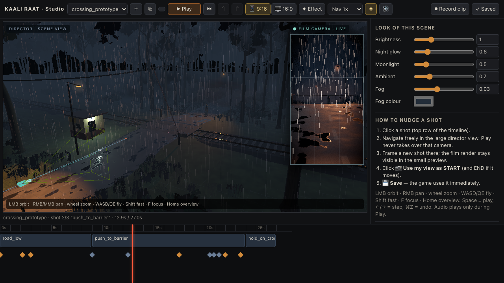
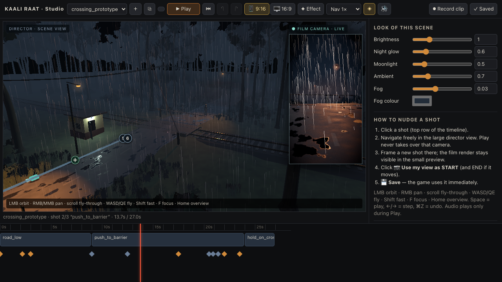
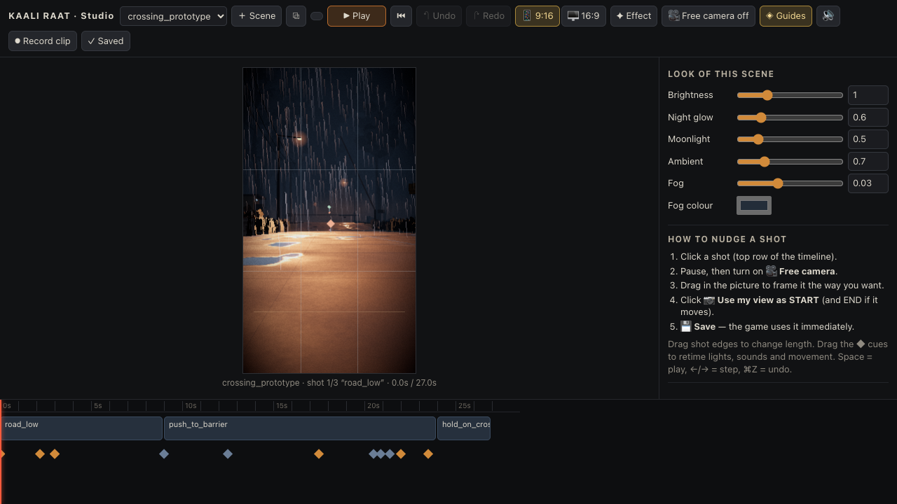
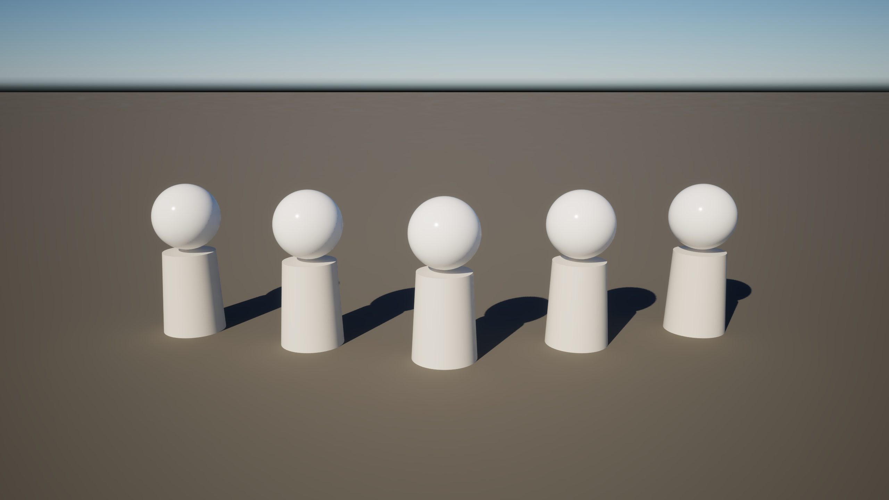

# CineCompose — Interactive Cinematic Story Engine

A high-performance, deterministic authoring suite for producing **branching, interactive cinematic experiences** at scale. CineCompose turns a script into production-ready branch videos through one unified 3D / camera / animation pipeline.



> **Not a game engine.** It's a *cinematic production pipeline*. It is designed to generate branching, interactive cinema (like *KAALI RAAT*) where users make decisions that lead to high-quality, pre-rendered video segments, rather than playing a real-time game. Three.js/R3F is the authoring layer; ThreeRT (native Rust/wgpu path tracer) is the offline render backend.

**Reference output:** [*KAALI RAAT — The Road That Remembers*](https://github.com/SumantxD/cinecompose), the first complete episode produced with this engine (78 validated paths, four endings, death/retry).

---

## Quick start

```bash
npm install
npm run dev
```

Then open one of these:

| URL | What you get |
|---|---|
| `http://localhost:5173/?start=part1` | The finished episode, played back |
| `http://localhost:5173/?studio` | **Director Studio** — the film editor |
| `http://localhost:5173/?characters` | **Character Lab** — the rig & motion editor |
| `http://localhost:5173/?start=prototype` | A 27-second cut, for a fast look at the look-dev |

```bash
npm run check      # walk every branch + validate scenes/sounds/timings — run before every commit
npm run typecheck
npm run build      # static dist/, deployable anywhere
```

---

## The three tools

### 1. Director Studio (`/?studio`)
Dual-view film editor: a free director camera on the left, the live film camera on the right. Everything you touch writes straight into the scene's JSON — no separate project file, no export step.


### 2. Character Lab (`/?characters`)
A specialized rig and motion editor for procedural character performance.


### 3. Story pipeline (`src/story/episode-001.ink`)
Branching narrative authored in **Ink**. The story decides *what happens*; the scene JSON decides *how you experience it*. Never mix the two.

---

## Director Studio tutorial

### The two views

| View | What it is |
|---|---|
| **Director (left)** | Where *you* are. Fly around freely, look at the set, position the camera. |
| **Film (right)** | What the *audience* sees through the shot currently on the timeline. |

The film view is read-only. You author camera moves by moving the director camera and clicking **Use my view as START** / **… as END**.

### Navigation (director view)

| Input | Effect |
|---|---|
| **Left mouse drag** | Orbit around the current pivot |
| **Right / middle mouse drag** | Pan the camera and pivot together |
| **Scroll wheel** | Constant-speed fly-through — no zoom limit, moves *through* the scene |
| **W / S** | Fly forward / back |
| **A / D** | Strafe left / right |
| **Q / E** | Fly down / up |
| **Shift** (held) | Multiply fly speed |
| **F** | Focus on whatever is selected (frames it in view) |
| **Home** | Overview — pull back to see the whole set |
| **Nav 0.5× / 1× / 2× / 4×** | Scale fly and pan speed |

> Touch: one finger orbits, two fingers pinch-dolly and pan. Authoring keys are never created by navigation — only real edits make keys.

### Orthographic placement views

| Key | Effect |
|---|---|
| **T** | Top-down orthographic — best for road/track layout |
| **B** | Bottom-up |
| **L** | Left orthographic — best for wall/height placement |
| **R** | Right orthographic |
| **FREE** | Back to the perspective director camera |

In an ortho view, **dragging drops you back into FREE orbit** at that exact spot — so you can position precisely, then swing around to check the frame. Scroll zooms the ortho camera; canonical targets persist.


### Authoring a camera move

1. Fly the director camera to where the shot should **start**.
2. Click **📷 Use my view as START**.
3. Fly to where it should **end**, click **📷 … as END**.
4. Click **Enable Bézier handles** to curve the path.


- **Numbered points** label every camera node. **Click a number** or **type its number** (multi-digit supported) to jump the film preview to that point.
- **Speed-colored spline pipes** show travel speed along the segment — colour shifts where the move accelerates.
- **Drag the ＋ handle** sitting on a pipe to insert a new point mid-segment (De Casteljau split, no length error).
- Position and **AIM** handles are separate — toggle with the *Editing position / Editing AIM* button. Handles link or unlink per node.
- Each segment carries its own **easing** (`sine.out`, `power2.inOut`, …) and **duration**.





### Effects at the playhead

Click **✦ Effect** then pick one: **light**, **entity**, **sound**, **ambience**, **title**, **fade**. Each lands as a cue on the timeline at the current playhead. Entity and sound cues get a draggable position handle in the director view; **📍 Put where the camera looks** snaps it to your orbit target.


### The timeline

- The **ruler** marks seconds (labels every 5s).
- **Shot bars** are draggable/selectable — click one to edit its type, duration, position/aim, or duplicate it.
- **Cue ticks** are coloured by action (`💡` light, `👣` entity, `🔊` sound, `🌧` ambience, `🅣` title, `⬛/⬜` fade). Cues from technique macros show greyed and edit in the JSON.
- **Caption strips** show each line's speaker and text, sized by its hold duration.

### Studio shortcuts

| Shortcut | Effect |
|---|---|
| **Space** | Play / pause the scene |
| **← / →** | Step the playhead back / forward **0.1 s** |
| **⇧← / ⇧→** | Step the playhead back / forward **1 s** |
| **⌘Z** | Undo |
| **⇧⌘Z** | Redo |
| **⌘S** | Save the scene to its JSON file |
| **T / B / L / R** | Top / Bottom / Left / Right ortho view |
| **F** | Focus the director camera on the selection |
| **Home** | Overview of the whole set |
| **0–9** | Jump the film preview to camera point *n* (type multiple digits fast for points ≥ 10) |
| **W A S D Q E** | Fly the director camera |
| **Shift** | Fly faster |

Audio follows the 🔇/🔊 control during **Play**. Pausing and scrubbing are **always silent** — no accidental audio bursts while you edit.

---

## Character Lab tutorial


- **Rotate / Move** toggles the transform gizmo between FK rotation and IK translation on the selected joint.
- **Joint** dropdown selects any bone, or an IK handle (`ik:hand_l`, `ik:hand_r`, `ik:foot_l`, `ik:foot_r`).
- **Drag any joint in the viewport** to key it at the current time. Keys appear in the per-track lanes below.
- **Gait speed** drives the procedural walk/contact cycle; ground contact is analytic, not a physics sim.
- **Duration** retimes FK keys, IK targets and facial keys together.
- **Library** switches between saved clips; **＋ New clip** / **Delete clip** manage them. **Remove joint keys** and **Clear all keys** are undoable.
- **Clip JSON** downloads the editable document; **Recovery JSON** recovers a previous unreadable draft. Import errors never replace valid data.

### Character Lab shortcuts

| Shortcut | Effect |
|---|---|
| **⌘Z** | Undo |
| **⇧⌘Z** | Redo |
| **← / →** | Step one frame (1/30 s) |
| **⏮** | Jump to the start of the clip |
| **F** | Focus the camera on the selected joint |
| **Home** | Overview — frames elevated and floor poses alike |

Exports are deterministic at 30 fps and re-importable through `GLTFLoader`. Morph targets and the shared 18-bone skeleton survive the round-trip.

---

## The story pipeline

```
src/story/episode-001.ink      →  StoryEngine  →  beats (scene id + lines + choices)
                                              ↓
                              scenes/<folder>/*.json   (shots, lighting, cues)
                                              ↓
                              cinematic/timeline.ts    (one GSAP timeline on the scene clock)
                                              ↓
                              app/player.ts            (scrub with clock.t → choices / next beat)
```

- **Ink** owns story, consequences, `# captured`, `# dead`. **Scene JSON** owns framing, timing, lighting. **Components** own geometry and behaviour.
- Everything visual reads `clock.t` — never wall time, never `Math.random()`. Use `utils/random.ts` (seeded). This is what makes Reels render frame-exact.
- A scene id with no JSON plays as a **black animatic** (rain + captions), so the whole episode stays playable while sets are being built.

`npm run check` walks **every** branch — 78 validated paths, four endings plus death/retry — and validates scenes, sounds, speakers and timings.

---

## Offline rendering with ThreeRT

`threert/` is the **production render backend**: a native Rust/wgpu path tracer used offline to render the branch videos on this Mac.

```bash
threert dev threert --port 8790     # dev server against the render project
threert check threert --json        # validate the scene
threert shot -o out.png --history 32
threert render threert -o out.png --spp 256   # converged offline frame
```

- **Native, not a browser plugin.** Hardware ray tracing via wgpu — validated on Apple M4 Pro (`hwrt: true`).
- **Offline Rendering:** Generate production-ready branch videos (MP4/WebM) frame-by-frame.
- **Zero Drift:** Because the story/camera is authoritative in the browser, ThreeRT renders the exact same frames that users experience in the interactive version.





---

## Assets & licensing

Everything is local, with provenance. See [`public/CREDITS.md`](public/CREDITS.md).

| Asset | Source | License |
|---|---|---|
| Fonts (Cormorant Garamond, Tiro Devanagari Hindi) | Google Fonts | SIL OFL 1.1 |
| Surface materials (9 map sets) | Poly Haven | CC0 |
| Motion (35 clips) | KinemIQ / Quaternius | CC0 |
| Audio | Procedural synthesis + baked WAVs | Apache-2.0 (Kokoro voice model) |
| Characters | Procedural stylized rigs | N/A |

Characters are **procedural stylized rigs** — no scanned human heads are integrated. Historical 3DAssets.dev content is not automatically CC0; NC/ND/paid/unclear-license content is excluded.

---

## Contributing

1. **Branch** off `main`.
2. **Read [`CLAUDE.md`](CLAUDE.md)** — it's the project's living system prompt and the fastest way to understand the conventions.
3. **Run `npm run check`** before every commit. It must stay green.
4. **Judge visuals with numbers, not one screenshot.** Target story-frame luma is 40–57 with spread ≥ 60, and no black stretches. Screenshot at **390×844** and **1280×720** before calling a visual change done. `scripts/audit-scenes.mjs` and `scripts/luma.sh` automate this.
5. **Commit small.** One coherent change per commit.

### Conventions worth knowing

- Story lives in **Ink**, timing in **scene JSON**, look in **components**. Never hardcode dialogue or camera moves in React.
- New camera behaviour goes in `cinematic/presets.ts`. New cue types go in `Cue` (`cinematic/types.ts`) plus `runCue` (`cinematic/timeline.ts`).
- Repeated scenery is **one `InstancedMesh` per archetype**, never one component per object. Heights come from analytic functions, never raycasts.
- Shader materials: build in `useMemo`, mutate `material.uniforms`. **Never** a JSX `uniforms` prop — R3F copies it and animation silently freezes.
- Every shot moves unless it's a deliberate hold. Every light or entity a cue targets needs an `id`.
- Film coverage by default: show the protagonist. First-person shots are rare, motivated inserts only.
- Mark deliberate shortcuts with `// ponytail: <ceiling> — <upgrade path>`.

The full decision log is in [`docs/decisions.md`](docs/decisions.md). Production and deployment notes are in [`docs/RELEASE.md`](docs/RELEASE.md).

---

## Current state

**Built:** the complete interactive episode (78 validated paths, four endings, death/retry), real tea-stall / childhood-house / return-road environments, Director Studio, Character Lab with 135 motions, layered shelter-aware rain, indoor sound profiles, ground mist, local fonts/textures, deterministic cameras and story/clock plumbing.

**In progress:**
- **Branch videos** — the browser delivery is moving to pre-rendered videos with decision overlays. The offline render pipeline (`threert/`) and the branch-video player are the current focus.
- **Full Hindi voiceover** — 149 clips are generated and the opening is wired; the rest of the episode is captioned. Timing collisions across conditional branches are being resolved before the full dub ships.

**Known gaps:** episode characters are procedural mannequins in close-up (licensed human/hair assets not yet integrated); no public hosting provider is configured yet.

No future seasons or episodes are planned in this repo.
