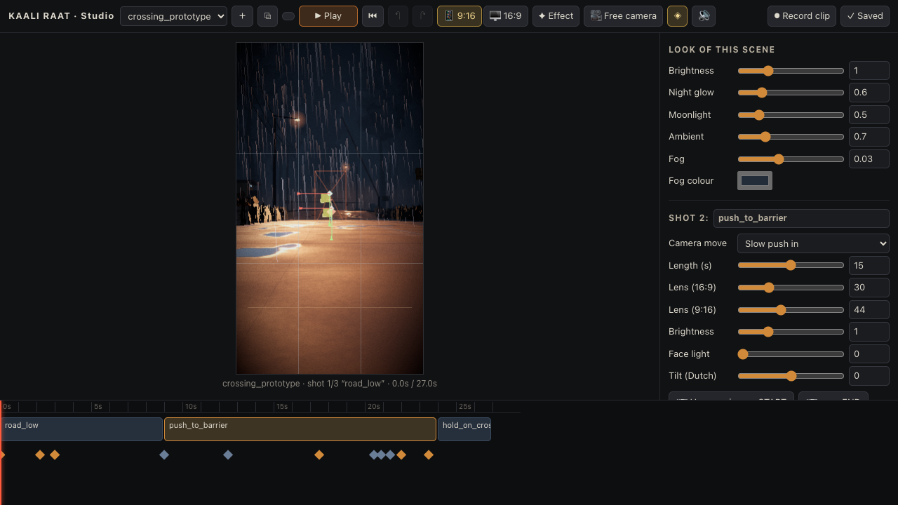

# CineCompose — Interactive Cinematic Story Engine

A high-performance, deterministic authoring suite for producing branching, interactive cinematic experiences. CineCompose automates the path from story scripts to production-ready branch videos using a unified 3D, camera, and animation pipeline.


## The Core Concept

CineCompose is **not a game engine**. It is a **cinematic production pipeline**. It is designed to generate branching, interactive cinema (like *KAALI RAAT*) where users make decisions that lead to high-quality, pre-rendered video segments, rather than playing a real-time game.

## The Authoring Suite

### 1. Director Studio
A dual-view film editor for orchestration.
- **Real-time Film Preview:** Synchronized view of the director's perspective and the final camera framing.
- **Bézier Camera Paths:** Smooth, intuitive path interpolation for professional camera moves.
- **Non-destructive Editing:** Instant undo/redo, point insertion, and numbered camera waypoint management.
- **Live Film Orchestration:** Control lighting, camera, and effects in real-time with precision control.




### 2. Character Lab
A specialized rig and motion editor for procedural character performance.
- **Skinned Mesh Rigging:** Professional 18-bone IK/FK rigging.
- **Motion Library:** A massive, retargetable library of CC0 motions plus authored presets.
- **Facial & Expression Control:** Layered facial morphs for emotive, restrained performance.
- **Deterministic Export:** Export validated skeletal GLBs for frame-exact animation.

### 3. Deterministic Story Pipeline
- **Ink-Native Storytelling:** Branching narratives authored in Ink, compiled directly into game beats.
- **The Scene JSON Schema:** Unified configuration for lighting, shots, cues, and animations.
- **Single Scene Clock:** Every movement, light change, and sound follows a seeded, frame-exact clock, ensuring perfect reproducibility for Reel/Video exports.

## Production-Grade Rendering

### ThreeRT (Native Ray-Tracing)
CineCompose uses **ThreeRT** as an offline, native Rust/wgpu render backend. 
- **Native Performance:** High-fidelity path-traced renders on Apple M4 Pro.
- **Offline Rendering:** Generate production-ready branch videos (MP4/WebM) frame-by-frame.
- **Zero Drift:** Because the story/camera is authoritative in the browser, ThreeRT renders the exact same frames that users experience in the interactive version.


## Key Features

- **Branch Video Delivery:** High-quality pre-rendered video clips with decision overlays.
- **Mobile-First Architecture:** Optimized for vertical Reels and portrait playback.
- **Asset Integrity:** Strict CC0-only provenance tracking and local-only asset serving.
- **Scale-Ready:** Designed to generate entire series of branching stories in bulk.

## Quick Start

```bash
npm install
npm run dev        # http://localhost:5173/?start=part1
```

- `?studio`: Enter the Director Studio
- `?characters`: Open the Character Lab
- `?start=prototype`: Run the quick cinematic prototype

## Project Status

**Reference Story:** [KAALI RAAT](https://github.com/SumantxD/cinecompose) (The first complete episode produced with this engine).
**Current Focus:** Refining the offline branch-video pipeline and completing the full Hindi-voiced integration for the reference story.
