# CineCompose — Interactive Cinematic Story Engine

A high-performance, deterministic authoring suite for producing **branching, interactive cinematic experiences** at scale. CineCompose turns a script into production-ready branch videos through one unified 3D / camera / animation pipeline.


> **Not a game engine.** It's a *cinematic authoring pipeline* for branching, decision-driven cinema (like *KAALI RAAT*). Three.js/R3F is the rendering and authoring layer. Studio can record the actual film camera; no native ray tracer or separate story runtime is included.

**Reference output:** [*KAALI RAAT — The Road That Remembers*](https://github.com/SumantxD/cinecompose), the first complete episode produced with this engine (78 validated paths, four endings, death/retry).

---

## Quick start

```bash
npm install
npm run dev
```

Then open one of these:

| URL | What you get |
|---|---|
| `http://localhost:5173/?start=part1` | The finished episode, played back |
| `http://localhost:5173/?studio` | **Director Studio** — the film editor |
| `http://localhost:5173/?characters` | **Character Lab** — the rig & motion editor |
| `http://localhost:5173/?start=prototype` | A 27-second cut, for a fast look at the look-dev |

```bash
npm run check      # walk every branch + validate scenes/sounds/timings — run before every commit
npm run typecheck
npm run build      # static dist/, deployable anywhere
```

---

## Authoring tools

### 1. Director Studio (`/?studio`)
Dual-view film editor: a free director camera on the left, the live film camera on the right. Everything you touch writes straight into the scene's JSON — no separate project file, no export step.


### 2. Character Lab (`/?characters`)
A specialized rig and motion editor for procedural character performance.
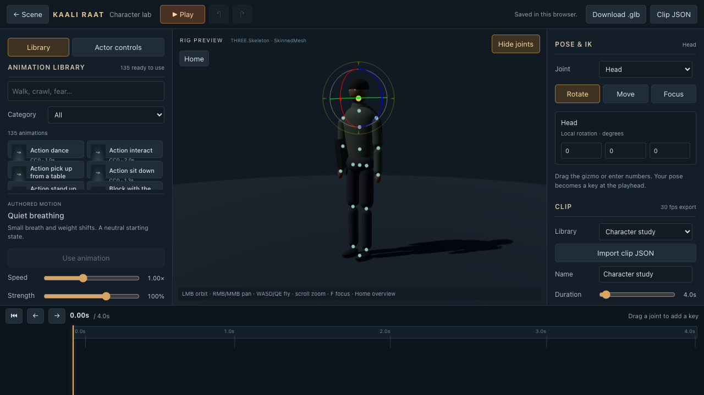

### 3. Story pipeline (`src/story/episode-001.ink`)
Branching narrative authored in **Ink**. The story decides *what happens*; the scene JSON decides *how you experience it*. Never mix the two.

### 4. World Builder (Studio workspace)

Generate an editable scene from a seed, a short story description, or a reference image. The same specification drives terrain, routes, landmarks, lighting and framing; output is ordinary scene JSON in `src/scenes/procedural-world/`. Existing scenes are never overwritten.

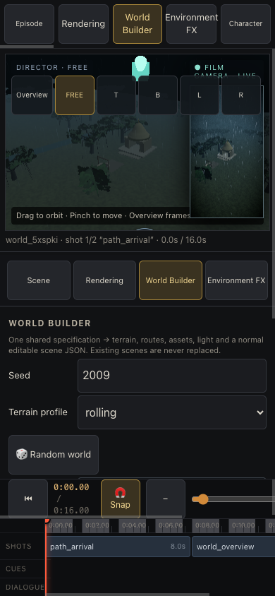

Story parsing is an offline grammar adapter, not an LLM. Images provide measured pixels plus horizon/vegetation observations; optional supplied depth produces bounded, labelled relative 2.5D observations, not a complete reconstruction. The depth model is not bundled, and image inputs do not invent unmentioned buildings. Save the generated world, then use the normal camera, weather, effects and Rendering panels to refine it.

---

## Director Studio tutorial

### The two views

| View | What it is |
|---|---|
| **Director (left)** | Where *you* are. Fly around freely, look at the set, position the camera. |
| **Film (right)** | What the *audience* sees through the shot currently on the timeline. |

The film view is read-only. You author camera moves by moving the director camera and clicking **Use my view as START** / **… as END**.

### Navigation (director view)

| Input | Effect |
|---|---|
| **Left mouse drag** | Orbit around the current pivot |
| **Right / middle mouse drag** | Pan the camera and pivot together |
| **Scroll wheel** | Constant-speed fly-through — no zoom limit, moves *through* the scene |
| **W / S** | Fly forward / back |
| **A / D** | Strafe left / right |
| **Q / E** | Fly down / up |
| **Shift** (held) | Multiply fly speed |
| **F** | Focus on whatever is selected (frames it in view) |
| **Home** | Overview — pull back to see the whole set |
| **Nav 0.5× / 1× / 2× / 4×** | Scale fly and pan speed |

> Touch: one finger orbits, two fingers pinch-dolly and pan. Authoring keys are never created by navigation — only real edits make keys.

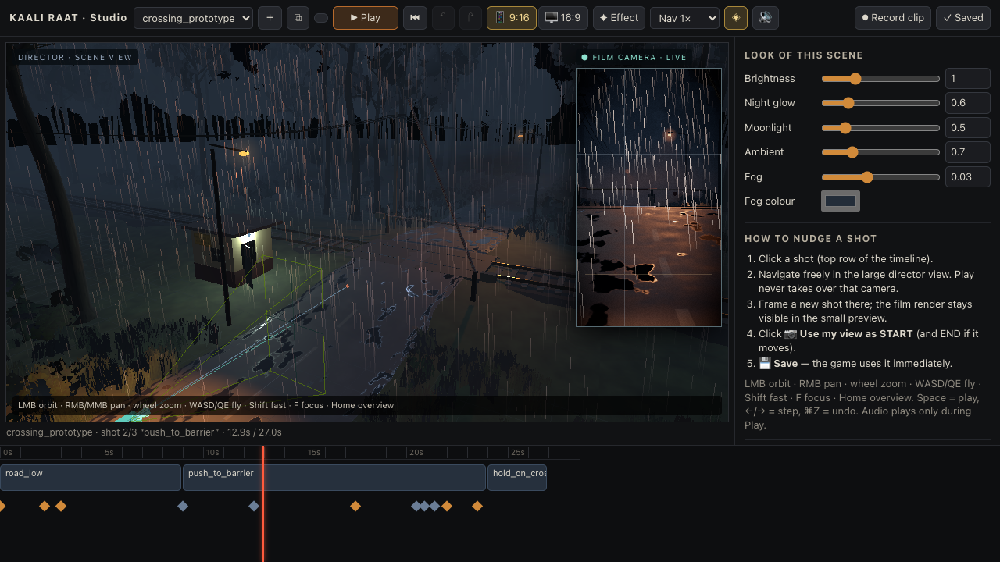

### Orthographic placement views

| Key | Effect |
|---|---|
| **T** | Top-down orthographic — best for road/track layout |
| **B** | Bottom-up |
| **L** | Left orthographic — best for wall/height placement |
| **R** | Right orthographic |
| **FREE** | Back to the perspective director camera |

In an ortho view, **dragging drops you back into FREE orbit** at that exact spot — so you can position precisely, then swing around to check the frame. Scroll zooms the ortho camera; canonical targets persist.

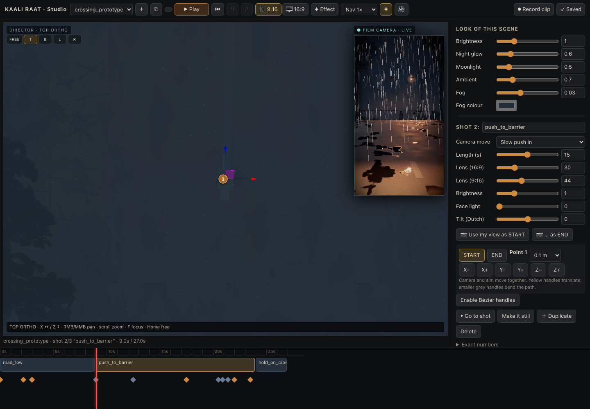

### Authoring a camera move

1. Fly the director camera to where the shot should **start**.
2. Click **📷 Use my view as START**.
3. Fly to where it should **end**, click **📷 … as END**.
4. Click **Enable Bézier handles** to curve the path.


- **Numbered points** label every camera node. **Click a number** or **type its number** (multi-digit supported) to jump the film preview to that point.
- **Speed-colored spline pipes** show travel speed along the segment — colour shifts where the move accelerates.
- **Drag the ＋ handle** sitting on a pipe to insert a new point mid-segment (De Casteljau split, no length error).
- Position and **AIM** handles are separate — toggle with the *Editing position / Editing AIM* button. Handles link or unlink per node.
- Each segment carries its own **easing** (`sine.out`, `power2.inOut`, …) and **duration**.

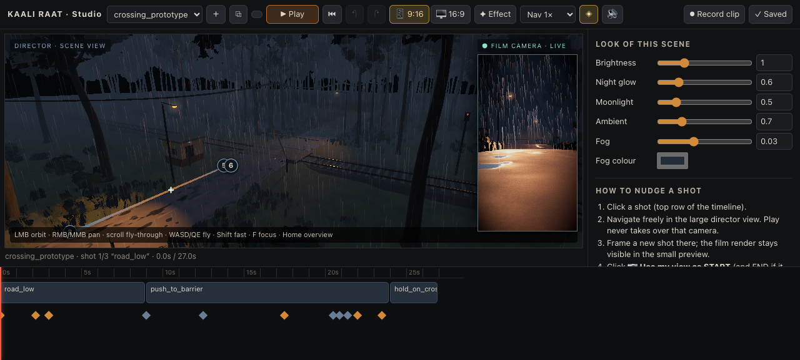


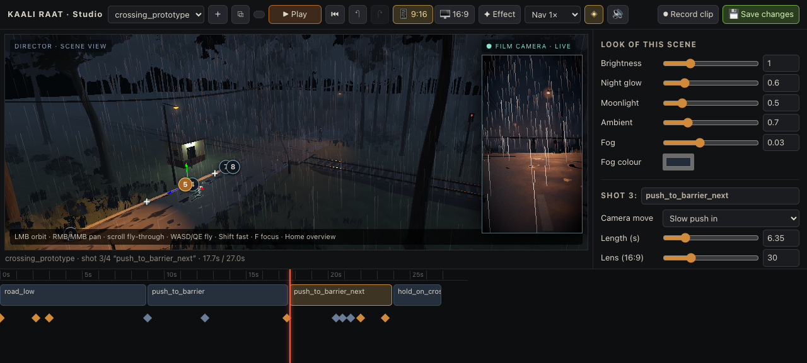
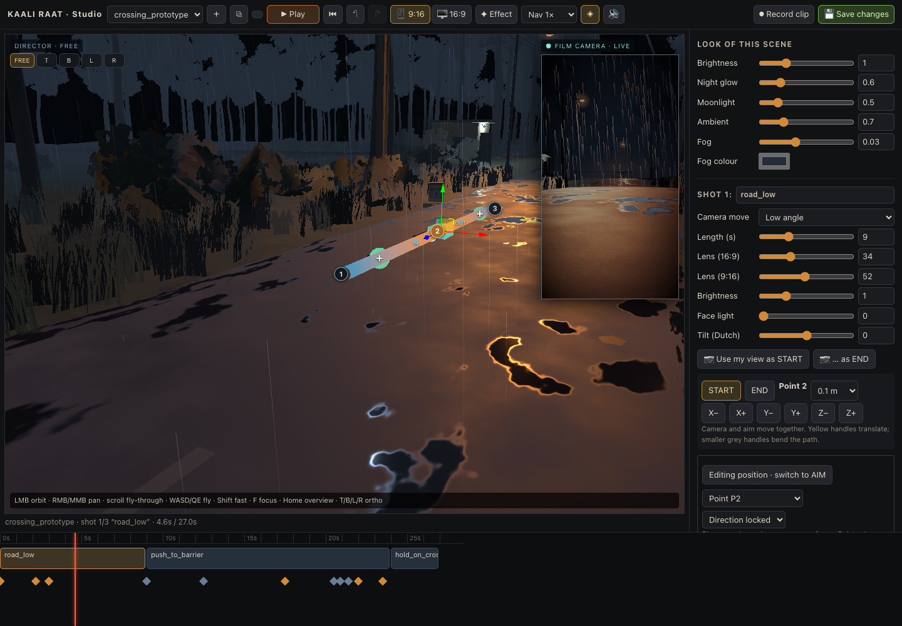

### Weather & look

The right-hand panel edits the scene's environment directly — changes write into the scene JSON and preview live.

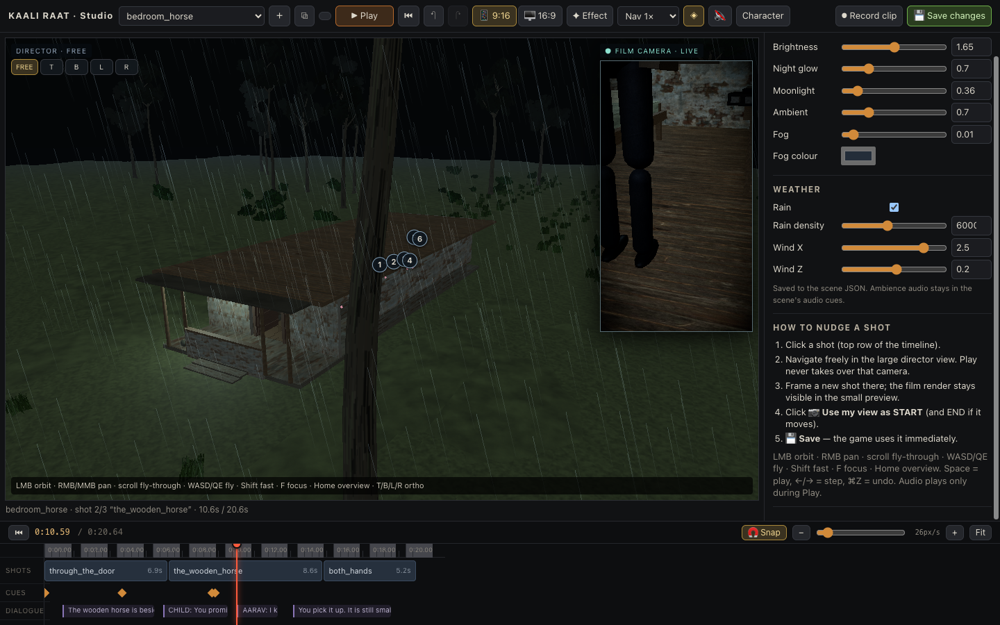

- **Look:** scene brightness (exposure), night glow, moonlight, ambient fill, fog density and fog colour. Per-shot exposure is set on the selected shot.
- **Weather:** toggle outdoor **rain** on/off, set **rain density** (GPU streaks; `0` keeps the environment's own default), and drift direction with **Wind X / Wind Z**. Rain is shelter-aware — it won't fall through roofs. Ambience audio is authored separately as audio cues.

These are authored per scene and saved like any other edit (`⌘S`). Everything still reads the shared `clock.t`, so the preview and the final render stay in sync.

### Rendering quality

Open **Rendering** in the Studio workspace switcher. Apply **Ultra**, **High**, or **Performance**, then adjust only what the shot needs.

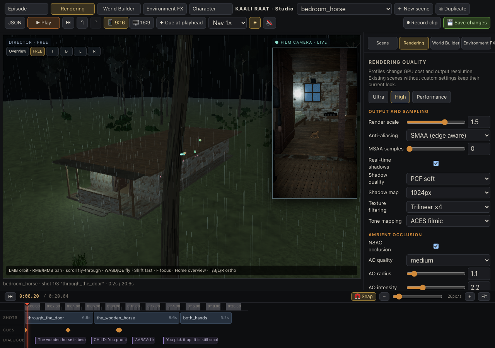

| Profile | Output DPR cap | Antialiasing | Occlusion | Shadows |
|---|---|---|---|---|
| **Ultra** | 2 | SMAA Ultra | N8AO Ultra, full resolution | PCF soft, 2048 |
| **High** | 1.5 | SMAA Medium | N8AO Medium, half resolution | PCF soft, 1024 |
| **Performance** | 1 | SMAA Medium | N8AO Performance, half resolution | PCF, 512 |

The workspace also controls shadow resolution, trilinear texture filtering, DOF, bloom, grade, vignette, grain, chromatic aberration, tone mapping and optional light shafts. DOF focus depth is the compositor's normalized depth; aperture maps to the installed effect's bokeh scale. **God rays** uses a real scene-space source, not a screen-space glare imitation.

- **Apply a profile to opt in.** A scene with no `rendering` block retains its legacy grade, DPR, shadow and vegetation behavior. **Customize** enters editing without replacing that legacy image.
- **Reset rendering** restores the scene's last saved rendering block. Normal save/undo applies.
- **Save preset / Load preset** transfers validated, portable rendering settings as JSON. Loading a preset does not upload anything.
- **Environment light** can use the local **Moonless Golf 1K HDRI** for restrained illumination; procedural night fill remains the default. Greg Zaal's CC0 source and the downloaded file's SHA-256 are in `public/CREDITS.md` and `public/environments/manifest.json`.
- Texture filtering is not a fake resolution downgrade: anisotropy is clamped to each GPU's capability, while all three profiles retain the source texture detail.

The budget readout samples the composed film renderer after its effects—not the guide-only director viewport. It is for comparing settings, not a promise of 30/60 FPS. Profile changes are functionally tested on desktop and at a 390×844 mobile layout; actual phone-GPU, thermal and per-scene art approval still need real-device checks. See [performance and budgets](docs/world/performance.md).

### Environment FX toolkit

These are **optional, reusable editor tools**, not events automatically added to KAALI RAAT. A scene has no environmental effects until you add one. Existing story scenes remain unchanged.

Use the **Environment FX** panel below Weather:

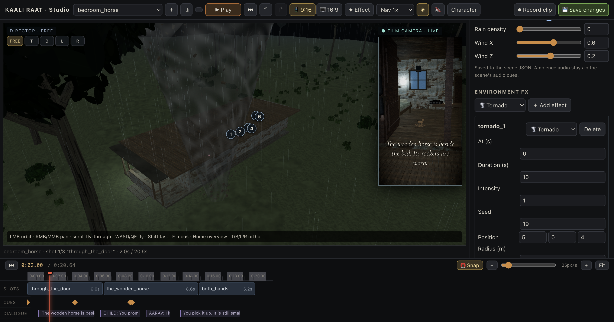

*This tornado is an unsaved test draft in the editor, not an authored KAALI RAAT event.*

1. Choose **Tornado**, **Lightning**, **Earthquake**, or **Flood** and click **＋ Add**.
2. Set **At**, **Duration**, and **Intensity**. Effects fade in/out at the ends of their active window.
3. Edit the type-specific parameters: funnel position/radius/height and debris, storm position and deterministic seed, rumble frequency, or flood level and water colour.
4. Scrub the timeline to preview exactly at a given time. **× Delete** removes the effect; undo and normal `⌘S` scene saving apply.

The configuration lives in the scene's `effects: []` array. Motion reads the scene clock and seeded randomness, so replaying a frame gives the same effect. The systems are controlled cinematic approximations: debris does not run a rigid-body simulation, the flood does not solve fluid dynamics, and earthquakes move the camera rather than destroying the set. No unrelated story logic is added.

### Effects at the playhead

Click **✦ Effect** then pick one: **light**, **entity**, **sound**, **ambience**, **title**, **fade**. Each lands as a cue on the timeline at the current playhead. Entity and sound cues get a draggable position handle in the director view; **📍 Put where the camera looks** snaps it to your orbit target.

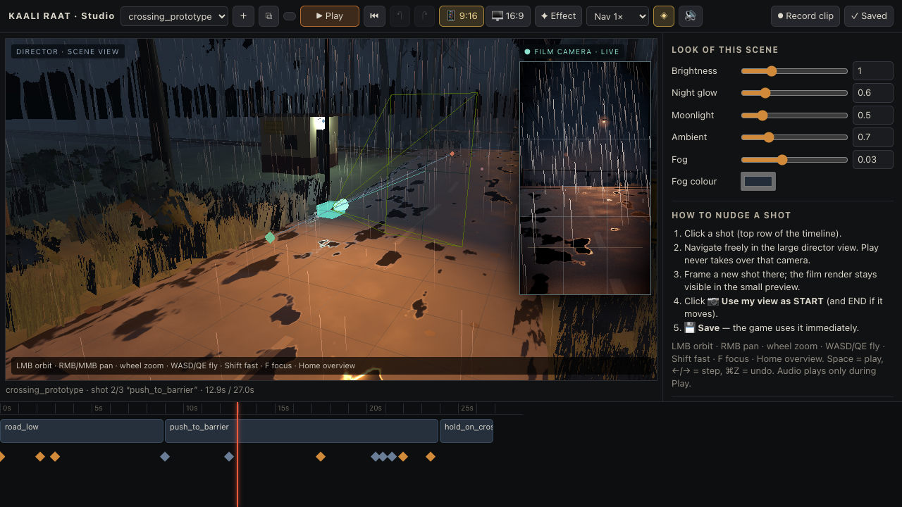

### The timeline

The timeline is designed to feel like a professional NLE (Non-Linear Editor).

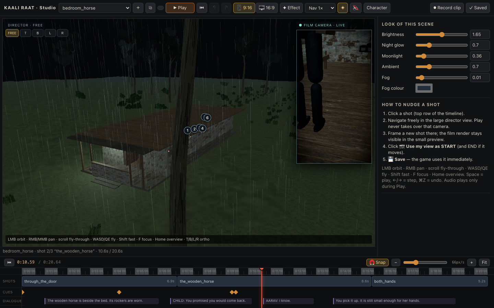

- **Zooming:** Scroll with `⌘/Ctrl` to zoom at the cursor, or use the timeline slider. 
- **Snapping:** A toggle switch enables magnetic snapping to shot boundaries, cue times, and a 0.05s grid.
- **The Ruler:** Displays adaptive ticks (0.1s to 60s) with precise timecodes (mm:ss.cs).
- **Playhead:** A vertical grab handle enables scrubbing to any position in the scene timeline.
- **Tracks:**
  - **Shots:** Define your camera moves. Resize them using the draggable right edge.
  - **Cues:** Small diamonds indicate timed audio, lighting, or entity events.
  - **Dialogue:** Compact strips represent every spoken line, sized by its exact hold duration.

### Studio shortcuts

| Shortcut | Effect |
|---|---|
| **Space** | Play / pause the scene |
| **← / →** | Step the playhead back / forward **0.1 s** |
| **⇧← / ⇧→** | Step the playhead back / forward **1 s** |
| **⌘Z** | Undo |
| **⇧⌘Z** | Redo |
| **⌘S** | Save the scene to its JSON file |
| **T / B / L / R** | Top / Bottom / Left / Right ortho view |
| **F** | Focus the director camera on the selection |
| **Home** | Overview of the whole set |
| **0–9** | Jump the film preview to camera point *n* (type multiple digits fast for points ≥ 10) |
| **W A S D Q E** | Fly the director camera |
| **Shift** | Fly faster |

Audio follows the 🔇/🔊 control during **Play**. Pausing and scrubbing are **always silent** — no accidental audio bursts while you edit.

---

## Character Lab tutorial


- **Rotate / Move** toggles the transform gizmo between FK rotation and IK translation on the selected joint.
- **Joint** dropdown selects any bone, or an IK handle (`ik:hand_l`, `ik:hand_r`, `ik:foot_l`, `ik:foot_r`).
- **Drag any joint in the viewport** to key it at the current time. Keys appear in the per-track lanes below.
- **Gait speed** drives the procedural walk/contact cycle; ground contact is analytic, not a physics sim.
- **Duration** retimes FK keys, IK targets and facial keys together.
- **Library** switches between saved clips; **＋ New clip** / **Delete clip** manage them. **Remove joint keys** and **Clear all keys** are undoable.
- **Clip JSON** downloads the editable document; **Recovery JSON** recovers a previous unreadable draft. Import errors never replace valid data.

### Character Lab shortcuts

| Shortcut | Effect |
|---|---|
| **⌘Z** | Undo |
| **⇧⌘Z** | Redo |
| **← / →** | Step one frame (1/30 s) |
| **⏮** | Jump to the start of the clip |
| **F** | Focus the camera on the selected joint |
| **Home** | Overview — frames elevated and floor poses alike |

Exports are deterministic at 30 fps and re-importable through `GLTFLoader`. Morph targets and the shared 18-bone skeleton survive the round-trip.

---

## The story pipeline

```
src/story/episode-001.ink      →  StoryEngine  →  beats (scene id + lines + choices)
                                              ↓
                              scenes/<folder>/*.json   (shots, lighting, cues)
                                              ↓
                              cinematic/timeline.ts    (one GSAP timeline on the scene clock)
                                              ↓
                              app/player.ts            (scrub with clock.t → choices / next beat)
```

- **Ink** owns story, consequences, `# captured`, `# dead`. **Scene JSON** owns framing, timing, lighting. **Components** own geometry and behaviour.
- Everything visual reads `clock.t` — never wall time, never `Math.random()`. Use `utils/random.ts` (seeded). This is what makes Reels render frame-exact.
- A scene id with no JSON plays as a **black animatic** (rain + captions), so the whole episode stays playable while sets are being built.

`npm run check` walks **every** branch — 78 validated paths, four endings plus death/retry — and validates scenes, sounds, speakers and timings.

---

---

## Assets & licensing

Everything is local, with provenance. See [`public/CREDITS.md`](public/CREDITS.md).

| Asset | Source | License |
|---|---|---|
| Fonts (Cormorant Garamond, Tiro Devanagari Hindi) | Google Fonts | SIL OFL 1.1 |
| Surface materials (9 map sets) | Poly Haven | CC0 |
| Motion (35 clips) | KinemIQ / Quaternius | CC0 |
| Audio | Procedural synthesis + baked WAVs | Apache-2.0 (Kokoro voice model) |
| Characters | Procedural stylized rigs | N/A |

Characters are **procedural stylized rigs** — no scanned human heads are integrated. Historical 3DAssets.dev content is not automatically CC0; NC/ND/paid/unclear-license content is excluded.

---

## Contributing

1. **Branch** off `main`.
2. **Read [`CLAUDE.md`](CLAUDE.md)** — it's the project's living system prompt and the fastest way to understand the conventions.
3. **Run `npm run check`** before every commit. It must stay green.
4. **Judge visuals with numbers, not one screenshot.** Target story-frame luma is 40–57 with spread ≥ 60, and no black stretches. Screenshot at **390×844** and **1280×720** before calling a visual change done. `scripts/audit-scenes.mjs` and `scripts/luma.sh` automate this.
5. **Commit small.** One coherent change per commit.

### Conventions worth knowing

- Story lives in **Ink**, timing in **scene JSON**, look in **components**. Never hardcode dialogue or camera moves in React.
- New camera behaviour goes in `cinematic/presets.ts`. New cue types go in `Cue` (`cinematic/types.ts`) plus `runCue` (`cinematic/timeline.ts`).
- Repeated scenery is **one `InstancedMesh` per archetype**, never one component per object. Heights come from analytic functions, never raycasts.
- Shader materials: build in `useMemo`, mutate `material.uniforms`. **Never** a JSX `uniforms` prop — R3F copies it and animation silently freezes.
- Every shot moves unless it's a deliberate hold. Every light or entity a cue targets needs an `id`.
- Film coverage by default: show the protagonist. First-person shots are rare, motivated inserts only.
- Mark deliberate shortcuts with `// ponytail: <ceiling> — <upgrade path>`.

The full decision log is in [`docs/decisions.md`](docs/decisions.md). Production and deployment notes are in [`docs/RELEASE.md`](docs/RELEASE.md).

---

## Current state

**Built:** the complete interactive episode (78 validated paths, four endings, death/retry), real tea-stall / childhood-house / return-road environments, Director Studio, Character Lab with 135 motions, layered shelter-aware rain, indoor sound profiles, ground mist, local fonts/textures, deterministic cameras and story/clock plumbing.

**Also built:** the optional Studio Environment FX toolkit (lightning, tornado, earthquake and flood, never added to story scenes unless authored).

**In progress:**
- **Branch-video export and player** — the Studio currently captures the live film view with MediaRecorder. A complete offline branch-video library and player have not been built.
- **Full Hindi voiceover** — 149 clips are generated and the opening is wired; the rest of the episode is captioned. Timing collisions across conditional branches are being resolved before the full dub ships.

**Known gaps:** episode characters are procedural mannequins in close-up (licensed human/hair assets not yet integrated); no public hosting provider is configured yet.

No future seasons or episodes are planned in this repo.
